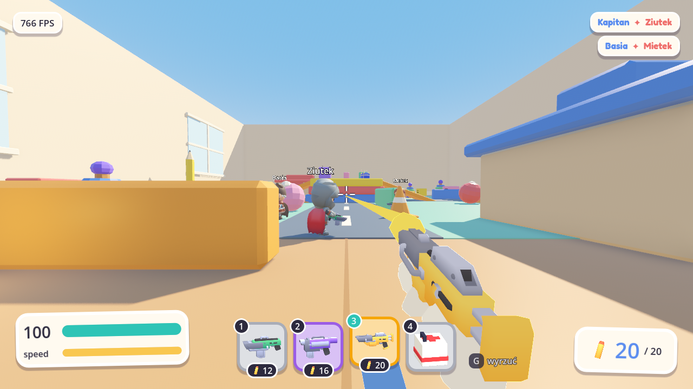
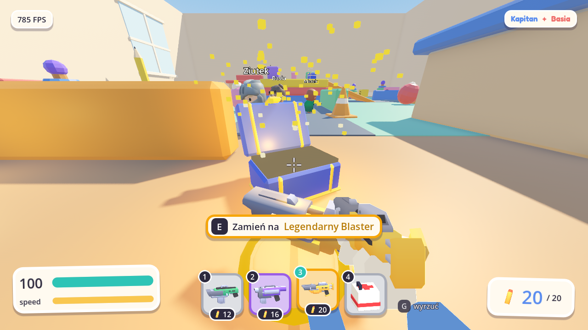
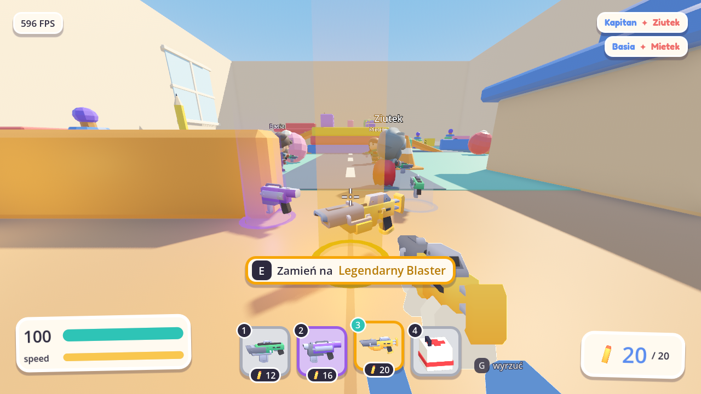
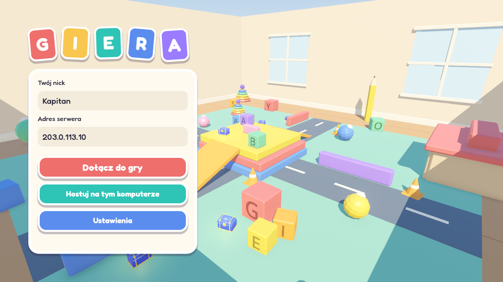
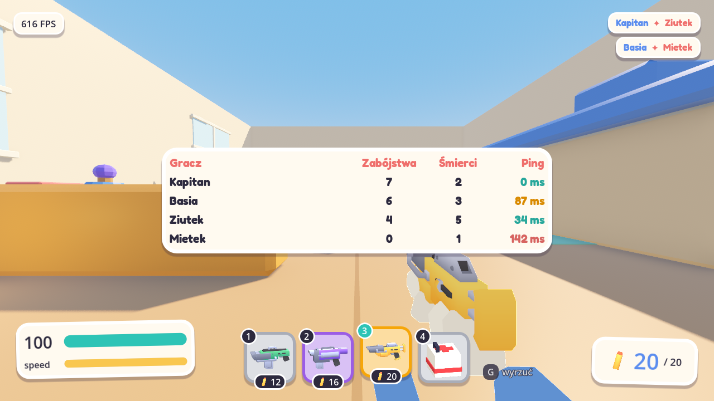
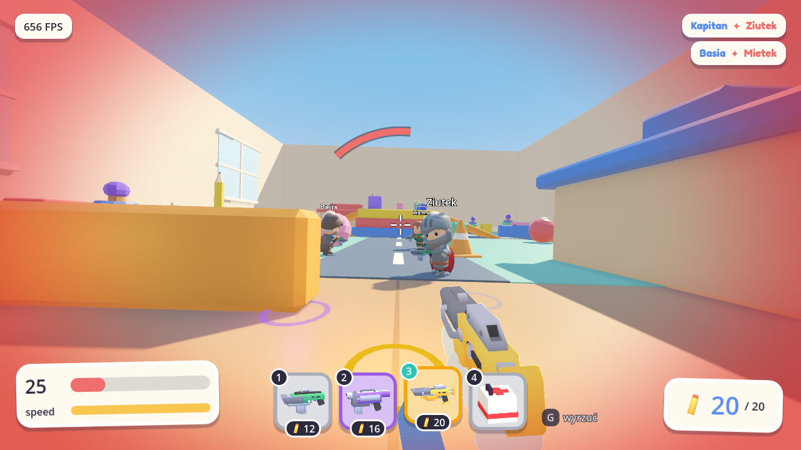

# Giera

Kolorowa strzelanka FPS multiplayer, w której gracze walczą jako małe figurki w pokoju pełnym wielkich zabawek.

| Skrzynka | Bronie na ziemi |
|---|---|
|  |  |

| Menu | Wyniki | Obrażenia |
|---|---|---|
|  |  |  |

## Co jest w grze

- **Multiplayer na żywo:** serwer dedykowany albo hostowanie z menu. Ruch reaguje od razu, a strzały liczą się tam, gdzie gracz widział cel na ekranie.
- **Trzy klasy broni:** zwykła, epicka i legendarna, każda z własnym modelem, parametrami, smugą i dźwiękiem.
- **Ekwipunek na 4 sloty:** szybka zmiana broni klawiszami lub scrollem, osobna amunicja w każdej broni.
- **Skrzynki z łupem:** rozsiane po mapie, otwierane przez przytrzymanie klawisza. Losują broń z szansą 70% na zwykłą, 25% na epicką i 5% na legendarną, a po minucie wracają.
- **Podnoszenie i wyrzucanie:** bronie leżą na ziemi, a po śmierci wypadają dla innych.
- **Apteczki:** wypadają ze skrzynek obok broni, a przytrzymanie strzału przez 2,5 s leczy o 50 punktów.
- **Sprint z limitem:** pasek zużywa się w biegu i odnawia po chwili odpoczynku.
- **Pokój zabawek:** mapa z książek, klocków, ołówków i piłek, animowane postacie i interfejs w stylu naklejek.
- **Czytelna walka:** kierunek trafienia, znaczniki trafień, lista zabójstw i tabela wyników z pingiem.

## Jak zagrać

Pobierz najnowszą wersję z zakładki [Releases](../../releases/latest):

- **Windows:** uruchom `Giera.exe`. Jeśli pojawi się SmartScreen, wybierz **Więcej informacji**, a potem **Uruchom mimo to**.
- **macOS:** rozpakuj `Giera-macOS.zip` i uruchom `Giera.app`. Aplikacja nie ma podpisu Apple, więc przy pierwszym uruchomieniu wybierz **Otwórz mimo to** w **Ustawienia systemowe → Prywatność i ochrona**.

W menu wpisz adres serwera i kliknij **Dołącz** albo wybierz **Hostuj na tym komputerze**. Hostowanie wymaga otwartego portu 7777/UDP.

## Sterowanie

| Klawisz | Akcja |
|---|---|
| **WASD** | Ruch |
| **Mysz** | Celowanie |
| **LPM** | Strzał, przytrzymanie używa apteczki |
| **R** | Przeładowanie |
| **Shift** | Sprint |
| **Spacja** | Skok |
| **1–4 / scroll** | Zmiana broni |
| **E** | Podniesienie przedmiotu, przytrzymanie otwiera skrzynkę |
| **G** | Wyrzucenie przedmiotu |
| **Tab** | Wyniki |
| **Esc** | Pauza i ustawienia |

## Technologia

Godot 4.7, GDScript i [netfox](https://github.com/foxssake/netfox). Serwer decyduje o przebiegu gry, klient przewiduje ruch i strzały, a strzelanie korzysta z cofania czasu, żeby rekompensować opóźnienie sieci.

## Licencja

Kod i własne pliki projektu są udostępnione wyłącznie do wglądu, a wszelkie prawa są zastrzeżone. Szczegóły są w pliku [LICENSE](LICENSE).

Składniki innych autorów zachowują swoje licencje: [netfox](https://github.com/foxssake/netfox) (MIT), postacie [KayKit Adventurers](https://kaylousberg.itch.io/kaykit-adventurers) (CC0), [Kenney Blaster Kit](https://kenney.nl/assets/blaster-kit) (CC0) i czcionka Fredoka (SIL OFL). Pliki licencji leżą przy zasobach.
