# Giera

Kolorowa strzelanka FPS multiplayer, w której gracze walczą jako małe figurki w pokoju pełnym wielkich zabawek.

| Skrzynka | Bronie na ziemi | Celowanie | Granat |
|---|---|---|---|
|  |  |  |  |

| Lobby Battle Royale | Poza strefą | Wyniki meczu |
|---|---|---|
| 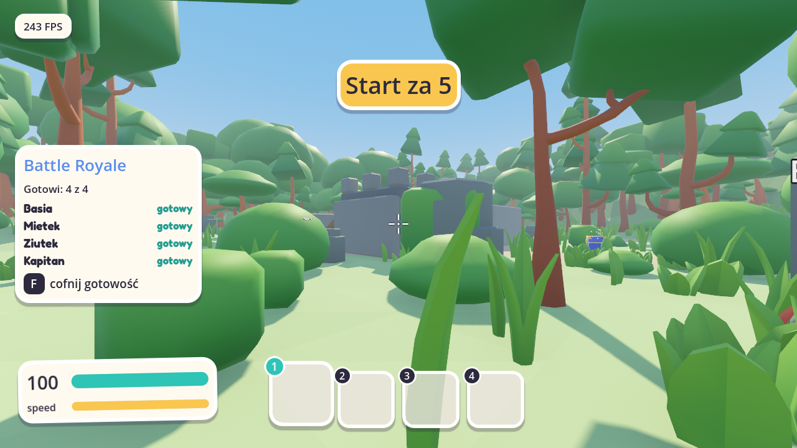 | 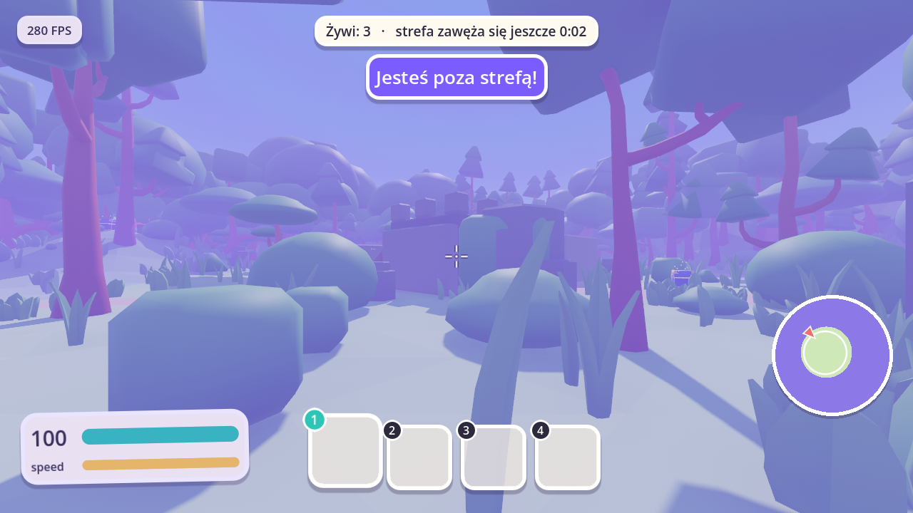 | 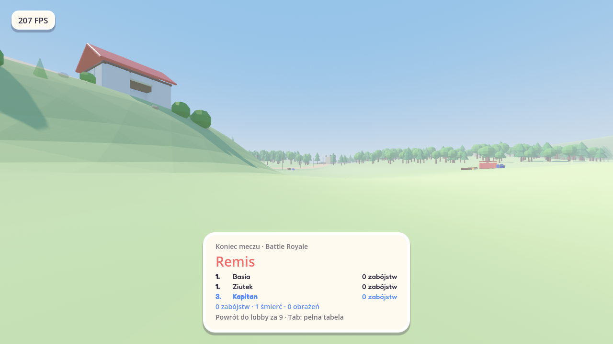 |

| Koło tańców | Taniec | Czat |
|---|---|---|
|  |  | 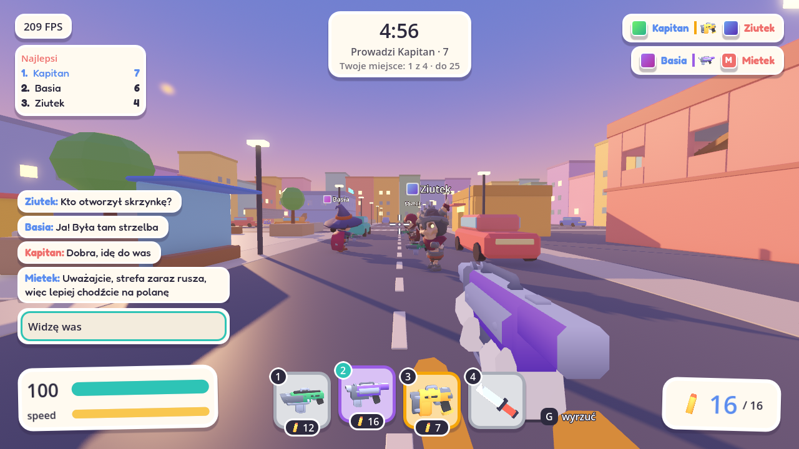 |

| Miasteczko | Plac w miasteczku | Dolina | Gospodarstwo w dolinie |
|---|---|---|---|
| 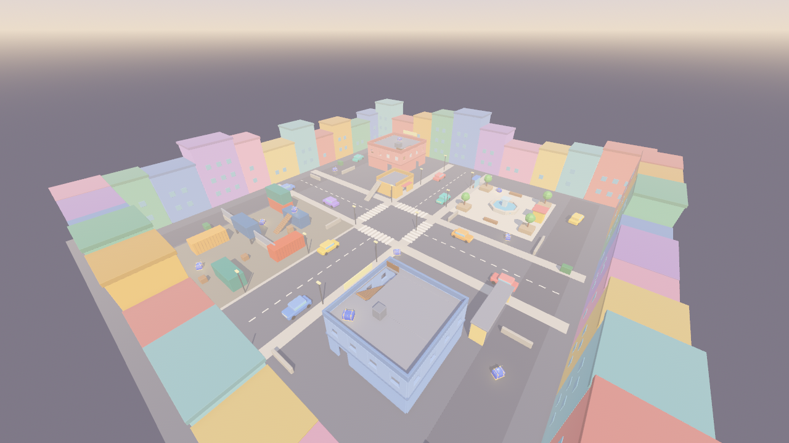 | 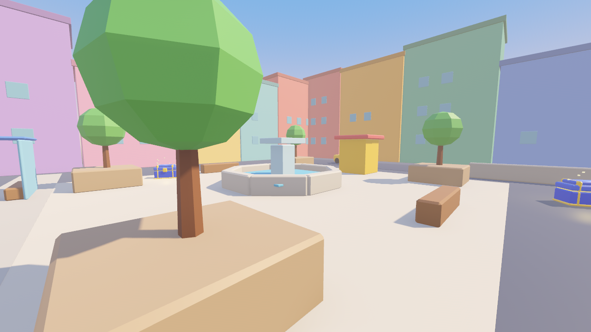 | 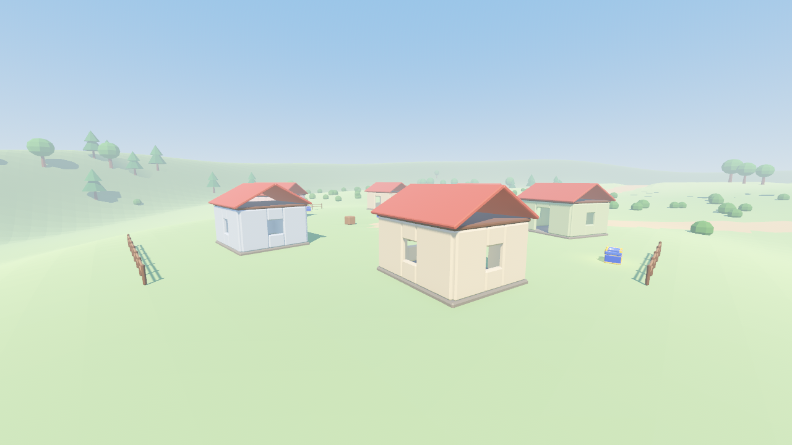 | 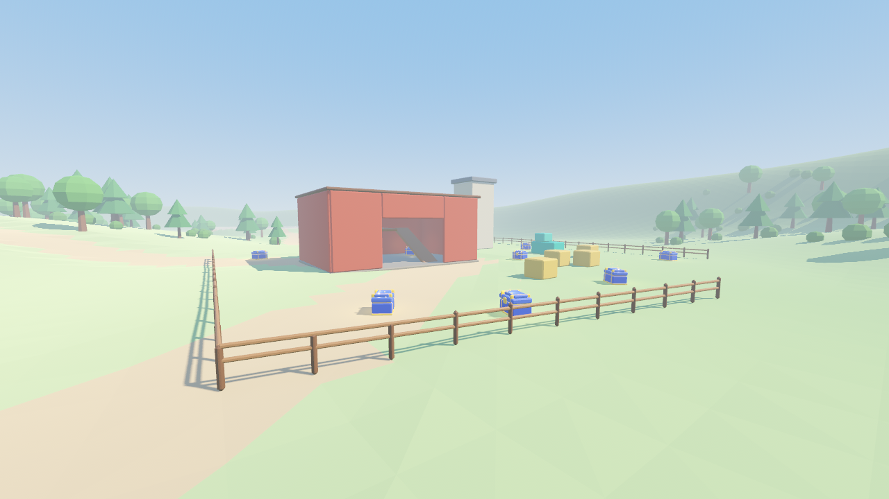 |

| Luneta AWP | Desert Eagle | Runda i ranking | Koniec rundy | Regeneracja |
|---|---|---|---|---|
| 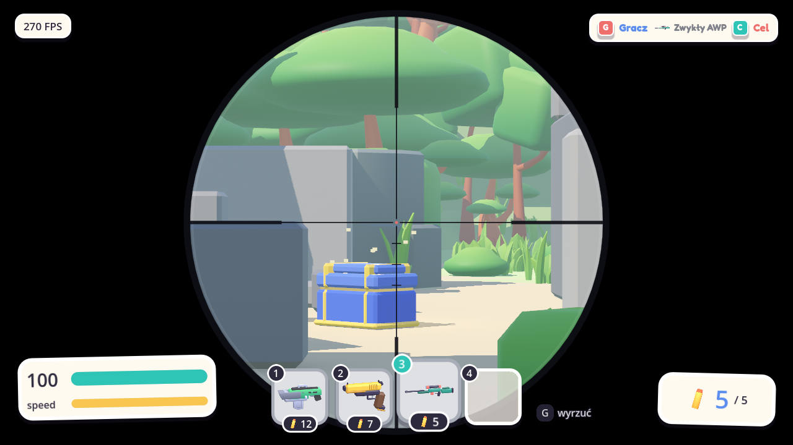 | 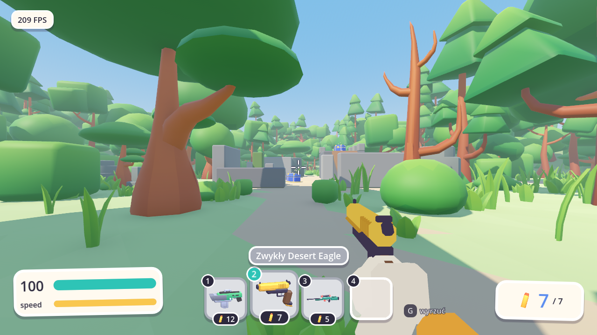 | 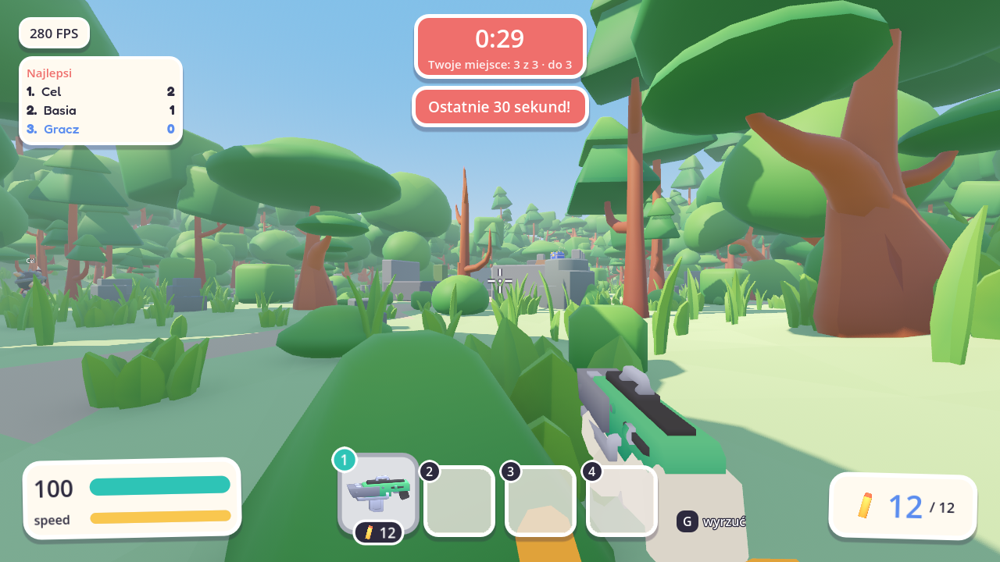 | 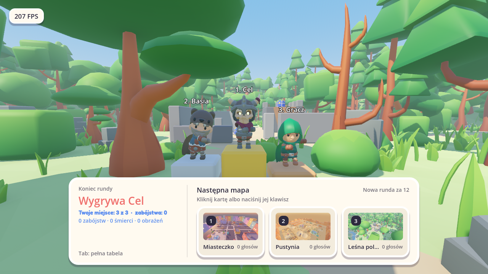 | 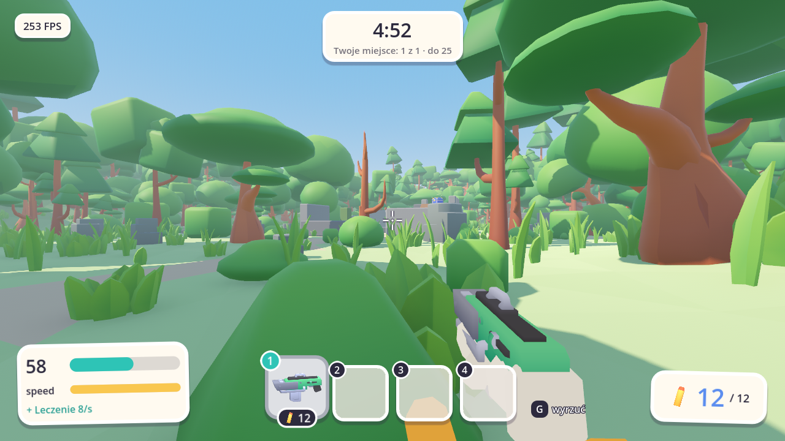 |

| Kucanie | Zmiana klawiszy | Zbrojownia | Porównanie broni |
|---|---|---|---|
| 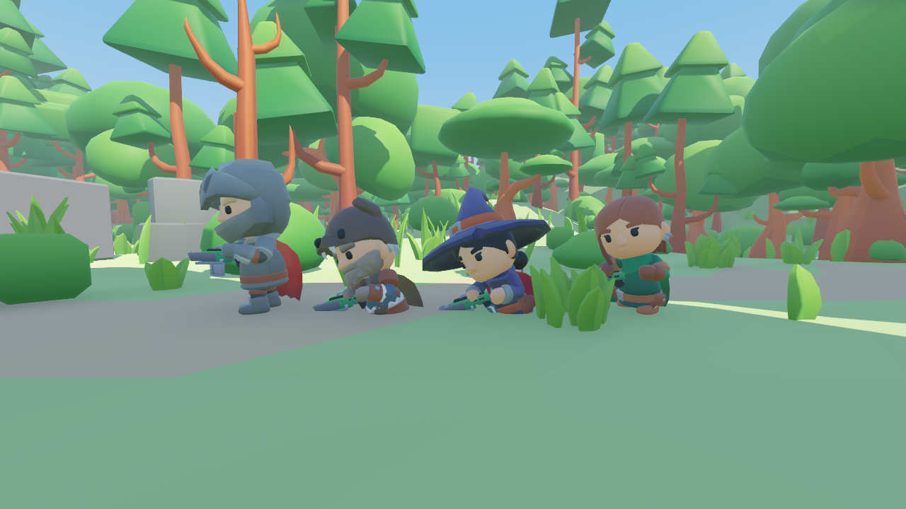 | 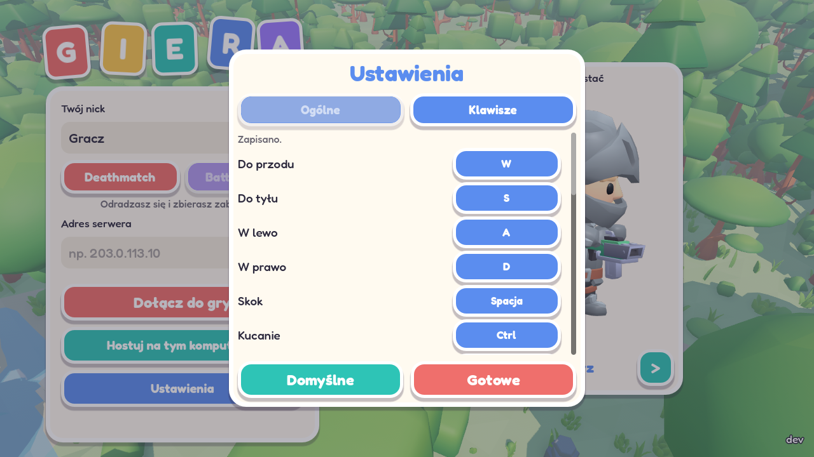 | 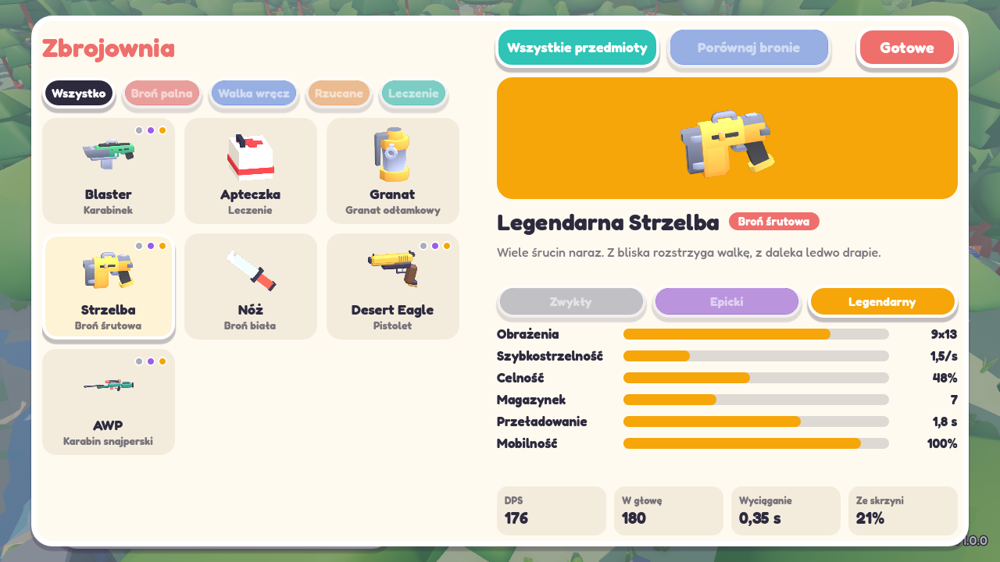 | 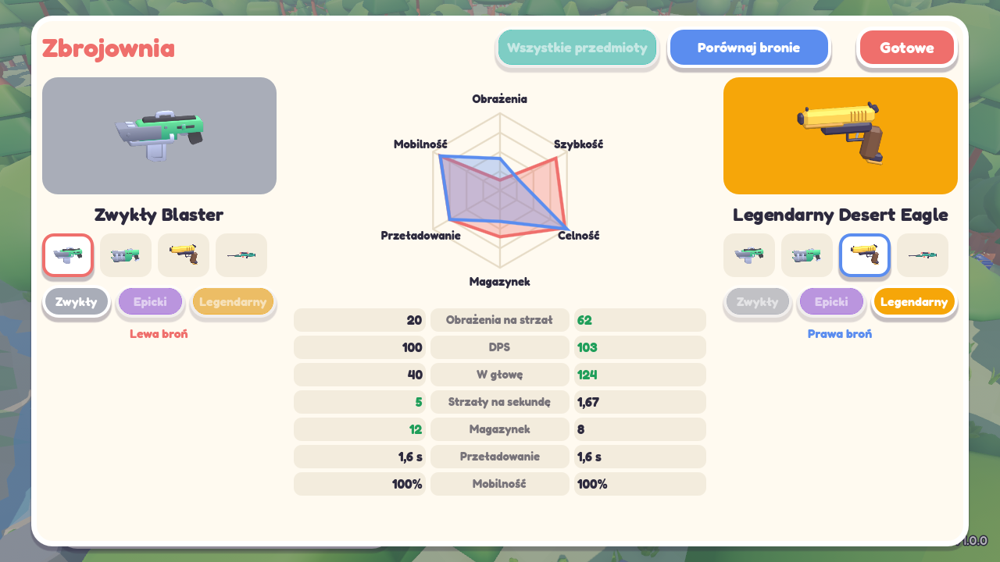 |

| Strzelba | Nóż | Menu | Wyniki | Obrażenia |
|---|---|---|---|---|
|  |  |  |  |  |

## Co jest w grze

- **Dwa tryby:** wybierasz je w menu głównym. Deathmatch to walka z odradzaniem, a w Battle Royale masz jedno życie.
- **Rundy Deathmatchu:** runda trwa 5 minut albo do 25 zabójstw lidera. Na górze ekranu widać zegar, lidera i Twoje miejsce, a z boku najlepszą trójkę. Ostatnie 30 sekund ma wyraźny sygnał. Na koniec trójka zwycięzców tańczy na podium, są nagrody za zabójstwa, celność i trafienia w głowę, a po 12 s rusza nowa runda z czystym stanem. Między rundami głosujesz klawiszami 1 i 2 na następną mapę.
- **Mapy:** Deathmatch gra w kolorowym **Miasteczku** o zachodzie słońca, z ulicami, placem z fontanną, kamienicą i hotelem z wejściem na dach, kontenerami i zaułkami. Są tam drabiny, rura i dwa przejścia tylko w kucki. Battle Royale gra w dużej **Dolinie** (ok. 200 m promienia) z sześcioma miejscami: Stare ruiny, Wioska, Gospodarstwo, Kamieniołom, Jezioro z mostem i Obóz na wzgórzu.
- **Regeneracja w Deathmatchu:** nie ma apteczek. Po 6 s bez obrażeń zdrowie wraca o 8 punktów na sekundę, a każde trafienie przerywa leczenie.
- **Desert Eagle i AWP:** Desert Eagle zabija dwoma trafieniami, a rzadki AWP jednym, z każdej odległości. Prawy przycisk z AWP daje lunetę na cały ekran, a strzał z niej wyrzuca.
- **Trafienia w głowę:** inny znacznik i dźwięk, ikona na liście zabójstw i liczby obrażeń nad celem (można je wyłączyć).
- **Ekran śmierci:** pokazuje, kto Cię zabił, jaką bronią i ile zdrowia mu zostało. W Deathmatchu odradzasz się z dala od wrogów i masz 2 s ochrony, która znika po strzale.
- **Serie zabójstw:** pierwsza krew, podwójne i potrójne zabójstwo, serie i ich przerwanie.
- **Zrzuty zaopatrzenia w Battle Royale:** skrzynia spada na spadochronie z kolorowym dymem i daje legendarny łup. Widać ją na mapce, a pod klawiszem M jest duża mapa z nazwami miejsc.
- **Ślady po kulach:** pociski zostawiają ślady i odpryski w kolorze powierzchni, a metal sypie iskrami.
- **Zbrojownia:** w menu głównym są wszystkie bronie i przedmioty z rodzajem, opisem, statystykami każdej klasy i szansą wypadnięcia ze skrzyni. Druga zakładka porównuje dwie bronie na wykresie i w tabeli.
- **Statystyki:** zabójstwa, celność i ulubiona broń zapisane tylko na Twoim komputerze, w menu pod przyciskiem Statystyki. Przy pierwszej grze samouczek pokazuje Twoje klawisze.
- **Battle Royale:** gracze czekają w lobby, aż wszyscy klikną Gotowe. Każdy startuje w innym miejscu i bez broni, więc pierwsze sekundy to wyścig do skrzynek. Strefa zacieśnia się w czterech fazach, a mapka pokazuje, dokąd uciekać. Wyeliminowani oglądają mecz do końca.
- **Multiplayer na żywo:** serwer dedykowany albo hostowanie z menu. Ruch reaguje od razu, a strzały liczą się tam, gdzie gracz widział cel na ekranie.
- **Trzy klasy broni:** zwykła, epicka i legendarna, każda z własnym modelem, parametrami, smugą i dźwiękiem.
- **Rozrzut:** najcelniej strzela się w miejscu i pierwszym pociskiem. Rośnie w ruchu, w skoku i w długiej serii, ale tylko do limitu, a lepsza broń ma go mniej. Celownik pokazuje go na żywo, a celowanie go zmniejsza.
- **Strzelba:** kilka śrucin naraz, ogromne obrażenia z bliska i słabe z daleka.
- **Nóż:** dwa ciosy zabijają, nie ma naboi, a z nożem w ręku biegniesz szybciej.
- **Ekwipunek na 4 sloty:** szybka zmiana broni klawiszami lub scrollem, osobna amunicja w każdej broni.
- **Skrzynki z łupem:** rozsiane po mapie, otwierane przez przytrzymanie klawisza. Każda daje jeden przedmiot: blaster, strzelbę, nóż, Desert Eagle, AWP, apteczkę albo granat (apteczki tylko w Battle Royale), a po minucie wraca. Wśród broni z klasami 55% to zwykłe, 35% epickie i 10% legendarne.
- **Tańce:** przytrzymanie klawisza otwiera koło z 6 tańcami, każdy z własnym ruchem i muzyką, którą słyszą też gracze obok. Kamera odjeżdża wtedy za postać, a każdy ruch przerywa taniec.
- **Lista zabójstw:** pokazuje, kto kogo zabił i jaką bronią.
- **Czat:** wiadomości widać nad paskiem zdrowia przez chwilę, a po otwarciu czatu całą rozmowę. Znikają po wyjściu z gry, bo nikt ich nie zapisuje.
- **Podnoszenie i wyrzucanie:** bronie leżą na ziemi, a po śmierci wypadają dla innych.
- **Apteczki:** przytrzymanie strzału przez 2,5 s leczy o 50 punktów.
- **Granaty:** przytrzymanie odbezpiecza, a puszczenie rzuca, więc można skrócić czas do wybuchu. Im bliżej wybuchu, tym większe obrażenia, a tuż obok giniesz od razu.
- **Celowanie:** prawy przycisk przybliża widok i zmniejsza odrzut, ale spowalnia ruch. Lepsza broń ma mocniejsze przybliżenie.
- **Konto Steam:** gra na Windows sama pobiera nazwę i zdjęcie profilowe z konta Steam. Zdjęcia widać w menu, w tabeli wyników, na liście zabójstw i nad graczami. Bez Steama wystarczy wpisać nick.
- **Wybór postaci:** 9 modeli do wyboru strzałkami w menu, w tym rycerze i szkielety. Gra zapamiętuje wybór.
- **Kucanie i ślizg:** przytrzymanie Ctrl obniża postać, spowalnia ją i zmniejsza rozrzut, a w sprincie daje krótki ślizg. Pod niskim sufitem nie wstaniesz, a w kucki przejdziesz pod niskimi przeszkodami. Strzał nad głową kucającego pudłuje także u gracza z dużym pingiem, a inni widzą Twoją pozę.
- **Zmiana klawiszy:** w ustawieniach, w menu i w pauzie, można przypisać każdą akcję do klawisza albo przycisku myszy. Zajęty klawisz zamienia się z poprzednim, a podpowiedzi w grze pokazują aktualne przypisanie.
- **Sprint z limitem:** pasek zużywa się w biegu i odnawia po chwili odpoczynku.
- **Leśna polana:** mapa w menu i druga mapa do głosowania w Deathmatchu, z ruinami i wieżą na środku, wzgórze, strumień i gęsty las dookoła, szum wiatru, śpiew ptaków i kroki zależne od podłoża, animowane postacie i żywy interfejs w stylu naklejek, który reaguje ruchem i dźwiękiem, z osobną głośnością.
- **Czytelna walka:** kierunek trafienia, znaczniki trafień, lista zabójstw i tabela wyników z pingiem.

## Jak zagrać

Pobierz najnowszą wersję z zakładki [Releases](../../releases/latest):

Pobierasz ją tylko raz: przy każdym uruchomieniu gra sama sprawdza i instaluje aktualizacje.

- **Windows:** rozpakuj `Giera-Windows.zip` do jednego folderu i uruchom `Giera.exe`. Jeśli pojawi się SmartScreen, wybierz **Więcej informacji**, a potem **Uruchom mimo to**.
- **macOS:** rozpakuj `Giera-macOS.zip` i uruchom `Giera.app`. Aplikacja nie ma podpisu Apple, więc przy pierwszym uruchomieniu wybierz **Otwórz mimo to** w **Ustawienia systemowe → Prywatność i ochrona**.

Jeśli Steam jest włączony, gra zaloguje Cię sama. W innym wypadku wpisz nick. Potem podaj adres serwera i kliknij **Dołącz** albo wybierz **Hostuj na tym komputerze**. Hostowanie wymaga otwartego portu UDP: 7777 dla Deathmatchu, 7778 dla Battle Royale.

Serwery dedykowane obu trybów uruchamia jedno polecenie: `docker compose up -d --build`.

## Sterowanie

| Klawisz | Akcja |
|---|---|
| **F** | Gotowość w lobby Battle Royale |
| **WASD** | Ruch |
| **Mysz** | Celowanie |
| **LPM** | Strzał lub cios nożem. Przytrzymanie używa apteczki albo odbezpiecza granat, a puszczenie go rzuca |
| **PPM** | Celowanie (przytrzymaj) |
| **R** | Przeładowanie |
| **Shift** | Sprint |
| **Spacja** | Skok |
| **Ctrl** | Kucanie (przytrzymaj), w sprincie ślizg |
| **M** | Duża mapa w Battle Royale (przytrzymaj) |
| **1–4 / scroll** | Zmiana broni, a na ekranie wyników głos na mapę |
| **E** | Podniesienie przedmiotu, przytrzymanie otwiera skrzynkę |
| **G** | Wyrzucenie przedmiotu |
| **B** | Przytrzymanie otwiera koło tańców. Puszczenie albo LPM wybiera taniec, a ruch go przerywa |
| **T** | Czat. Enter wysyła, Esc zamyka |
| **Tab** | Wyniki |
| **Esc** | Pauza i ustawienia |

Każdy klawisz zmienisz w **Ustawienia → Klawisze**.

## Technologia

Godot 4.7, GDScript i [netfox](https://github.com/foxssake/netfox). Serwer decyduje o przebiegu gry, klient przewiduje ruch i strzały, a strzelanie korzysta z cofania czasu, żeby rekompensować opóźnienie sieci.

## Licencja

Kod i własne pliki projektu są udostępnione wyłącznie do wglądu, a wszelkie prawa są zastrzeżone. Szczegóły są w pliku [LICENSE](LICENSE).

Składniki innych autorów zachowują swoje licencje: [netfox](https://github.com/foxssake/netfox) (MIT), [GodotSteam](https://codeberg.org/godotsteam/godotsteam) (MIT), biblioteki Steamworks SDK (umowa Valve), postacie [KayKit Adventurers](https://kaylousberg.itch.io/kaykit-adventurers) (CC0), [KayKit Skeletons](https://kaylousberg.itch.io/kaykit-skeletons) (CC0), [Kenney Blaster Kit](https://kenney.nl/assets/blaster-kit) (CC0), [KayKit Forest Nature Pack](https://kaylousberg.itch.io/kaykit-forest) (CC0) i czcionka Fredoka (SIL OFL). Pliki licencji leżą przy zasobach.
